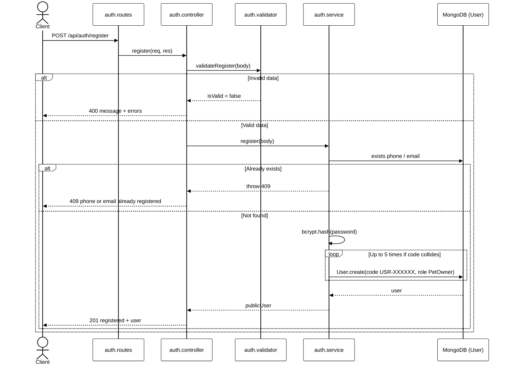
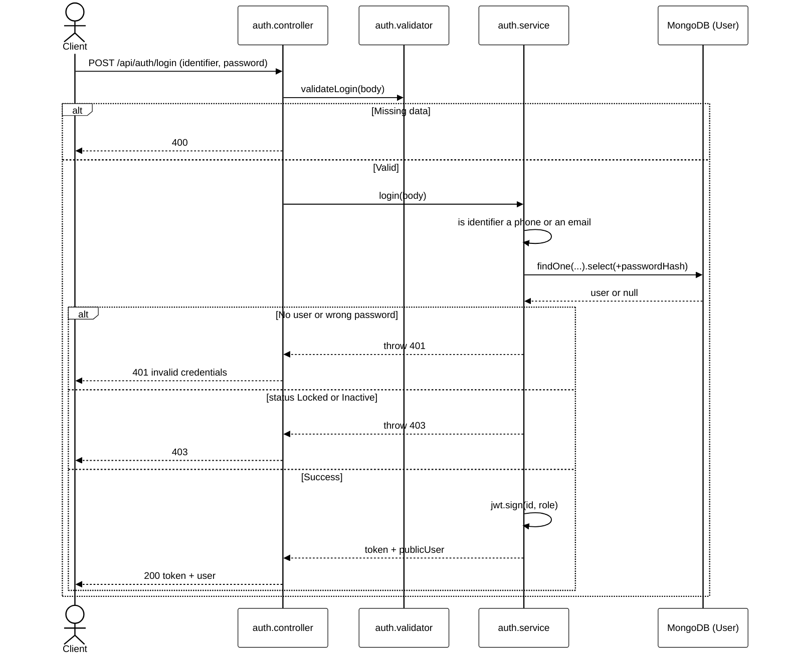
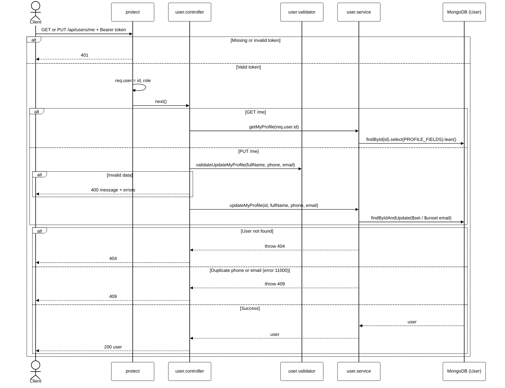
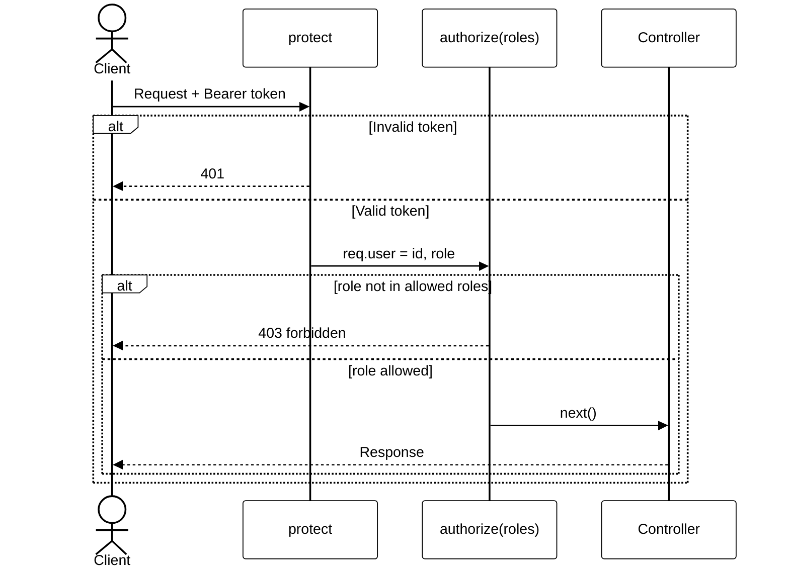
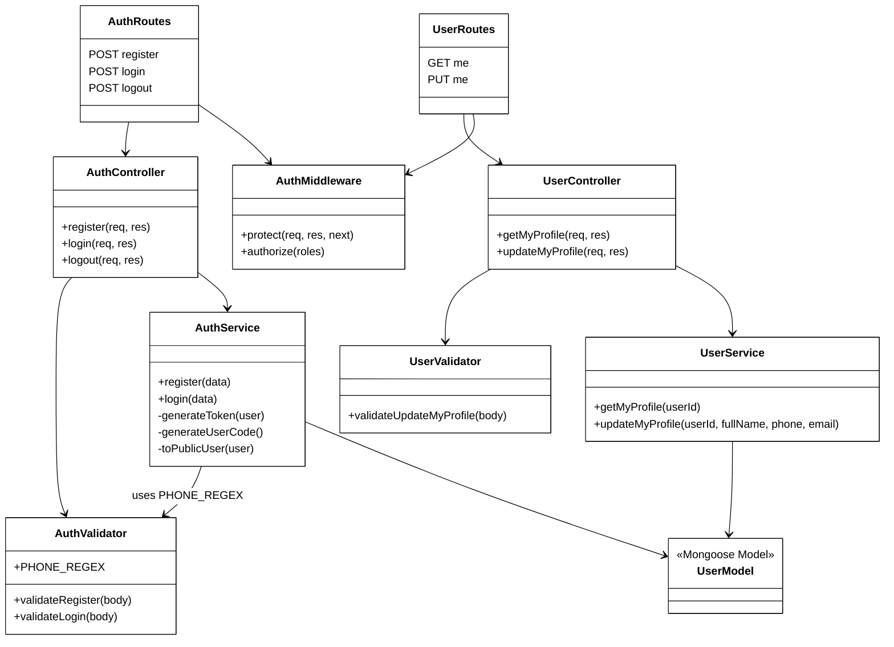
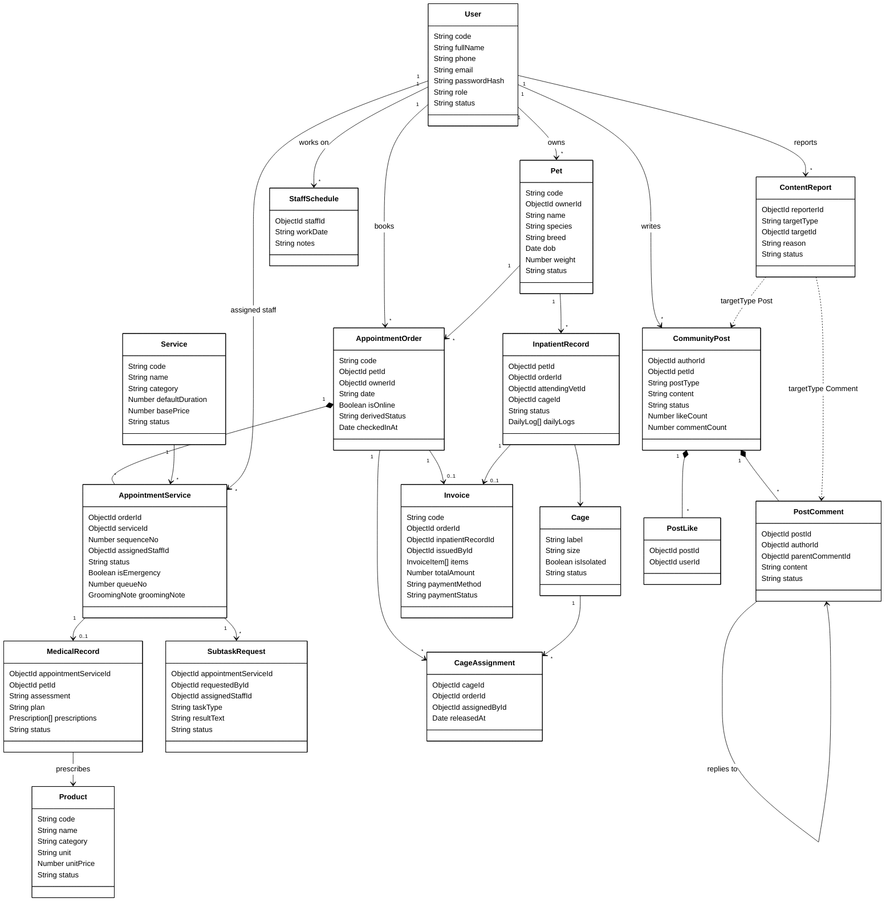

# VCMOS Backend: Tổng quan, Sequence Diagram và Class Diagram

## 1. Thông tin chung

| Mục | Nội dung |
|---|---|
| Công nghệ | Node.js, Express 5, Mongoose 9 (MongoDB), CommonJS |
| Xác thực | JWT (`jsonwebtoken`), mật khẩu băm bằng `bcryptjs` |
| Test | Jest + Supertest, chạy trên MongoDB local `vcmos_test` |
| Lệnh | `npm run dev` (nodemon), `npm start`, `npm test`, `npm run seed` |
| Port mặc định | `9999` |
| Cấu trúc | `routes → controllers → services → models`, kèm `validators/` và `middlewares/` |

### Cấu trúc thư mục
```
VCMOS_BE/
├── server.js                 # tạo app Express, gắn route
├── src/
│   ├── config/db.js          # kết nối MongoDB
│   ├── routes/               # auth.routes.js, user.routes.js
│   ├── controllers/          # auth.controller.js, user.controller.js
│   ├── services/             # auth.service.js, user.service.js
│   ├── validators/           # auth.validator.js, user.validator.js
│   ├── middlewares/          # auth.middleware.js (protect, authorize)
│   ├── models/               # 17 model Mongoose
│   └── seeds/seed.js         # dữ liệu mẫu
├── tests/                    # auth, authorize, user
├── api/                      # tài liệu từng API
└── docs/                     # tài liệu tổng quan (file này)
```

### Nhiệm vụ từng tầng
- **Route**: khai báo URL, HTTP method và các middleware cần chạy.
- **Middleware**: `protect` kiểm tra JWT rồi gán `req.user = { id, role }`. `authorize(...roles)` chặn những role không được phép (trả 403).
- **Controller**: nhận request, gọi validator (sai dữ liệu thì trả 400), gọi service, trả response.
- **Service**: xử lý nghiệp vụ, làm việc với DB. Gặp lỗi thì ném `httpError(status, message)`.
- **Model**: schema Mongoose và index.

### API đã có

| Method | URL | Auth | Mô tả |
|---|---|---|---|
| POST | `/api/auth/register` | Không | Đăng ký, role luôn là `PetOwner` |
| POST | `/api/auth/login` | Không | Đăng nhập bằng SĐT hoặc email, trả `{ token, user }` |
| POST | `/api/auth/logout` | Bearer | JWT stateless nên server chỉ trả 200, FE tự xoá token |
| GET | `/api/users/me` | Bearer | Xem profile của mình |
| PUT | `/api/users/me` | Bearer | Sửa `fullName`, `phone`, `email` của mình |

### Quy tắc nghiệp vụ chính
- **Số điện thoại là định danh chính:** bắt buộc, unique, đúng 10 số và bắt đầu bằng `0`.
- **Email không bắt buộc:** unique nếu có. Dùng partial index nên nhiều user không có email không bị coi là trùng.
- **Login không phân biệt** "sai tài khoản" hay "sai mật khẩu" (cùng trả 401, cùng message) để tránh bị dò tài khoản. Tài khoản `Locked` hoặc `Inactive` bị chặn với 403.
- **Token chỉ chứa** `id` và `role`. `passwordHash` có `select: false` và không bao giờ được trả ra response.
- **Mã user** có dạng `USR-XXXXXX` (ngẫu nhiên, không dùng ký tự dễ nhầm như 0/O/1/I). Nếu bị trùng thì sinh lại, tối đa 5 lần.
- **Role:** `PetOwner`, `Receptionist`, `Veterinarian`, `Groomer`, `Admin`.

---

## 2. Sequence Diagram

### 2.1 Đăng ký


### 2.2 Đăng nhập


### 2.3 Xem và sửa profile (có protect)


### 2.4 Phân quyền (authorize)
Hiện chưa có route nào dùng `authorize`. Đây là luồng khi gắn vào một route.


---

## 3. Class Diagram

### 3.1 Các tầng code (module đã làm)


### 3.2 Domain model (17 collection)


### Các ràng buộc unique quan trọng
| Model | Ràng buộc |
|---|---|
| User | `code`, `phone` unique. `email` unique khi có giá trị (partial index) |
| Pet, Service, Product, AppointmentOrder, Invoice | `code` unique |
| AppointmentService | (`orderId`, `sequenceNo`) unique |
| CageAssignment | Mỗi chuồng chỉ có 1 assignment đang mở (`releasedAt = null`) |
| InpatientRecord | Mỗi pet chỉ có 1 đợt nội trú `Admitted` |
| Invoice | `orderId`, `inpatientRecordId`, `vnpayTxnRef` unique khi có giá trị |
| MedicalRecord | `appointmentServiceId` unique (mỗi dịch vụ có 1 bệnh án) |
| PostLike | (`postId`, `userId`) unique, mỗi người like 1 lần |
| ContentReport | (`reporterId`, `targetType`, `targetId`) unique |
| StaffSchedule | (`staffId`, `workDate`) unique |
| Service / Product | (`category`, `name`) / (`name`, `unit`) unique |
